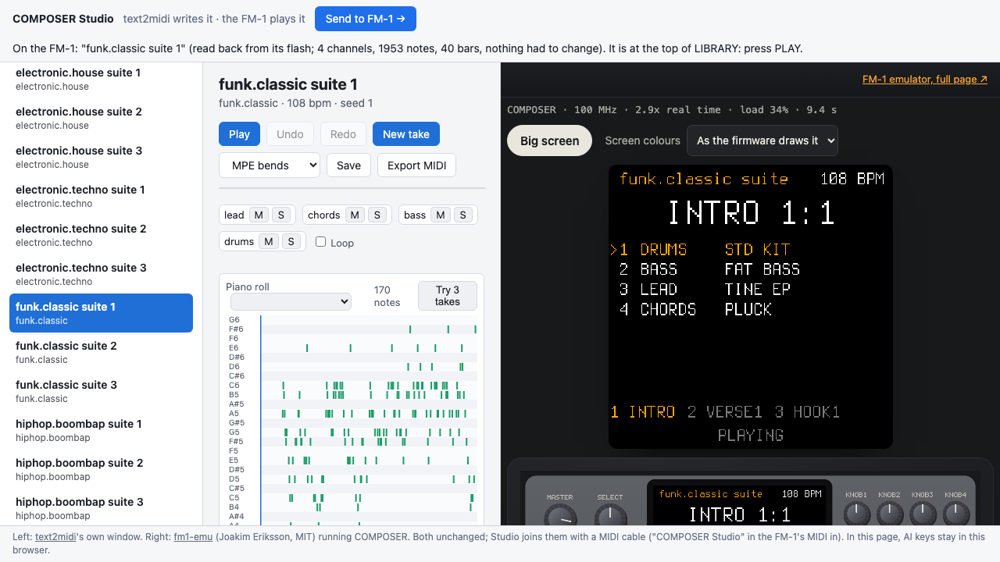

# fm1-composer

### ▶ Try it now: **[COMPOSER Studio, live in your browser](https://cindulasai.github.io/fm1-composer/)**: no install, no device

Describe a piece in a sentence (*"slow lo-fi in D minor, 70 bpm, warm keys and a lazy beat"*) and an AI writes a
full multi-part arrangement. One click sends it into an emulated M-VAVE FM-1 running **COMPOSER**, this repo's
firmware, and it plays on the device: every part with its own synth sound, drums from 32 kits, effects, sections you
launch live.

## Try it in three steps

1. Open **[COMPOSER Studio](https://cindulasai.github.io/fm1-composer/)**. Type a description, or pick one of
   text2midi's example pieces in the list (the examples need no AI key; for your own pieces you paste your own key,
   and it stays in your browser).
2. Press **Send to FM-1 →**. The piece goes in over the FM-1's MIDI IN and appears at the top of its LIBRARY.
3. Press **PLAY** on the FM-1 (or Space). Then make it yours:

| On the FM-1 | What you get |
| --- | --- |
| **KNOB1** + **PRESETS** | pick a part, change its sound (SLOOP's engines: FM, wavetable, analog, plucked, drums) |
| white keys | mute parts; hold **SEL** for solo; the upper keys launch sections (verse, hook…) at the next bar |
| **ARP** | play the keys yourself over the piece, locked to its key, with auto-chords (**ENV**) |
| **EDIT** / **LFO** | a piano roll / a step sequencer for any part, with undo |
| **REC** | record what you play into a part, overdub or replace |
| **FX** | reverb, delay, chorus, filter, drive per part |
| **SAVE** | keeps your sounds, edits and mix with the piece |

The full guide, every control and the Mac / Linux tool: **[app/README.md](app/README.md)**.

## What's in this repo

- **COMPOSER**: community firmware for the M-VAVE FM-1 that plays a library of up to 8-part pieces made on your
  computer. Its synth engines, effects and drum kits come from the SLOOP firmware, reused with provenance.
- **COMPOSER Studio**: the page above. text2midi's window and the [fm1-emu](https://github.com/joakimeriksson/fm1-emu)
  emulator side by side, joined by a virtual MIDI cable. Run it locally with `app/fm1c studio`.
- **fm1c**: the command-line tool that converts MIDI (or has text2midi compose it), fits it to the FM-1 and pushes it
  over USB.

**Status:** developed and tested in the fm1-emu emulator only; not yet run on a real FM-1.

Licence: GPL-3.0-only ([LICENSING.md](LICENSING.md)).
