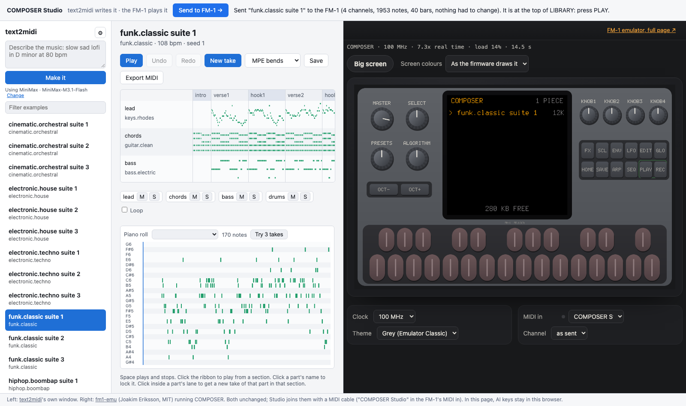

# COMPOSER for the M-VAVE FM-1

COMPOSER is community firmware for the M-VAVE FM-1. It turns the FM-1 into a player for finished, multi-part
arrangements made on your computer. You keep a library of pieces on the FM-1, pick one, play it, and choose
the sound of each of its up to 8 channels on the device. Mute and solo channels as it plays and set the tempo.
Your choices are saved with the piece.

**COMPOSER Studio** writes those pieces with you, in your browser. Describe the music in plain English, and an AI
writes a brief. [text2midi](https://github.com/cindulasai/text2midi_v2)'s composer, running in the page, turns it into
a full arrangement, and one click pushes it to the FM-1 beside it, where you play it and hear it. On the computer,
`fm1c` also turns any MIDI file into a piece and pushes it over USB. Every reduction made to fit the FM-1 is reported.



It is inspired by [SLOOP](https://github.com/isod89/sloop-fm1). It is a different instrument, a library player
rather than a live groovebox, and is built on the same community platform (Dinghy / Felucca).

> **Status:** developed and tested in the emulator [fm1-emu](https://github.com/joakimeriksson/fm1-emu)
> (including its on-chip timing mode). It has **not yet been run on a real FM-1**. Installing a community
> firmware on hardware is at your own risk.

## Quick start (in the emulator)

From the `app` folder of this repository (macOS on Apple silicon, or Linux; Python 3.11+):

```sh
python3 -m venv ../.venv && ../.venv/bin/pip install -q -r tools/requirements.txt && ../.venv/bin/python -m playwright install chromium-headless-shell
```

Then:

```sh
sh tools/get_emu.sh                                         # fm1-emu 0.5.1, checksum-verified, into ../vendor
gh run download -n composer-fwsc -D build                   # the firmware CI built (needs the GitHub CLI)
./fm1c emu                                                  # COMPOSER in fm1-emu, with USB
./fm1c convert song.mid -o song.f1p                         # in a second terminal
./fm1c push song.f1p                                        # "pushed 1, verified 1"
```

`fm1c emu` keeps the emulated FM-1's library in `~/.fm1c/emu-flash.bin`, so it is still there next time
(`--flash FILE` picks another).

## COMPOSER Studio

One page, two apps you may already know, joined by a MIDI cable:

- **Left: [text2midi](https://github.com/cindulasai/text2midi_v2)'s own window**, the same one as its desktop app.
  Describe the music and press **Make it**, or pick an example. Reroll any part, try takes, lock what you like, undo,
  and hear it with **Play**. text2midi's composer runs in the page (compiled to WebAssembly); the AI is called straight
  from the page with your own key.
- **Right: [fm1-emu](https://github.com/joakimeriksson/fm1-emu)'s own page**, the FM-1 emulator, running COMPOSER.
  Studio shows up in its **MIDI in** list as "COMPOSER Studio", like a MIDI keyboard would.
- **Send to FM-1** fits text2midi's piece to the FM-1 (every change is listed) and plays it into that cable, into the
  FM-1's MIDI IN (more slowly when the emulator runs slower than real time on this computer). Studio reads the piece
  back from the emulated flash before it says "On the FM-1". Press PLAY on the
  FM-1 (or Space) to hear it there.

Both apps run unchanged, at pinned versions: Studio adds only the cable, the Send button, and the small stand-in
that answers text2midi's window in the browser in place of its desktop shell.

To run it, from `app` (after the Quick start's first line; needs Rust and Node.js, see "Building and checking"):

```sh
sh tools/get_web_emu.sh             # fm1-emu's page, built at its pinned commit
gh run download -n composer-fwsc -D build                   # the firmware CI built
sh tools/studio_key.sh              # optional: your MiniMax key into a git-ignored file
./fm1c studio                       # builds Studio once, then opens http://127.0.0.1:8714/
```

text2midi's **Settings** (⚙) takes a key for any of its providers instead. In this page the key stays in this browser
(text2midi's window says "system keychain": that is its desktop app), and it is sent only to the provider you picked.
`tools/studio_key.sh` writes `studio/web/local/ai.json` (git-ignored, readable only by you). `fm1c studio` serves
the page to this computer only (127.0.0.1).

## Playing

| Screen | Control | Does |
| --- | --- | --- |
| LIBRARY | SELECT | moves through the pieces, newest first |
| | PLAY | opens the piece and plays it |
| PLAYER | PLAY | stops / plays (from the start) |
| | KNOB1 (or SELECT) | picks a channel |
| | PRESETS | changes that channel's sound, heard at once |
| | KNOB2 | tempo, 30 to 300 BPM |
| | white keys F3 to F4 (1 to 8) | mute channel 1 to 8 |
| | hold SEL + white key | solo |
| | SAVE | keeps the sounds, mutes and tempo for this piece (when stopped; while playing it saves at the stop) |
| | HOME | stops and goes back to the library |
| | EDIT | opens the selected channel in EDIT |
| | FX | opens the selected channel's effects |
| FX | SELECT | picks the row: REVERB, DELAY, CHORUS, FILTER, RESO, DRIVE |
| | KNOB1 | sets it (0 to 127; RESO 0 to 10), heard at once |
| | KNOB2 | the next / previous channel |
| | PLAY / SAVE | as in PLAYER (SAVE keeps the effects with the piece) |
| | HOME (or FX) | back to PLAYER |
| EDIT | SELECT | moves the cursor one grid step |
| | a note key | adds that note at the cursor (you hear it), or removes it if it is already there |
| | KNOB1 | grid: 1/32, 1/16, 1/8, 1/4 |
| | KNOB2 / KNOB3 | length / velocity of the note at the cursor (and of the next new one) |
| | OCT- / OCT+ | the keys an octave down / up (the roll follows) |
| | FX | undo (the last 64 edits) |
| | PLAY | plays from the cursor's bar / stops; edits wait until it is stopped |
| | SAVE | saves the edited piece in place of the old one, with your sounds, mutes and tempo |
| | HOME | back to PLAYER; leaving the piece with unsaved edits asks for HOME twice |

EDIT shows one channel as a piano roll: 16 grid steps across, the pitches of the 27 note keys down, the cursor's
step lit, notes in amber (a note begun before the page in grey). `*` after the channel's name means unsaved edits.

The player shows each channel's role (LEAD, BASS, DRUMS…), its sound and M / S, with the position as
bar:beat. There are 40 sounds from six Felucca engines plus COMPOSER's own drum kits. A piece starts each channel
on its instrument's sound: text2midi's instrument (named in the track), else the part's General MIDI program (an
electric piano plays TINE EP, an upright bass ROUND BASS, a GM drum kit one of the kits; the one table is
`tools/fm1c/sounds.py`). A part with neither starts on its role's default sound, and fm1c lists it in its report.

Every channel has SLOOP's effects: sends to a shared reverb (SLOOP's feedback delay network), a delay that follows
the tempo (1/8 note) and a chorus, plus a low-pass FILTER with RESO and DRIVE (SLOOP's DIST). After them, SLOOP's
look-ahead limiter keeps a loud mix clean. Each role starts with fitting effects (a pad wet, the bass and drums dry);
the code is SLOOP's own, copied (`firmware/SLOOP-PROVENANCE.md`).

## fm1c

```
fm1c convert FILE.mid [-o OUT.f1p] [--name NAME] [--poly 1..16] [--force]
fm1c compose BRIEF.json [--seed N] [-o OUT.f1p] [--t2m PATH]     text2midi's t2m-cli, unchanged
fm1c push FILES... [--no-wait]                                     each piece read back to verify
fm1c list | delete ID | pull ID [-o OUT]
fm1c emu [--fwsc FILE] [--flash FILE]
fm1c studio [--port N] [--no-open]                                 COMPOSER Studio in your browser
```

By default fm1c finds the FM-1 by its USB name ("Felucca", as with every Felucca-based firmware), else
"FM-1". `--port PART-OF-NAME` or `$FM1C_PORT` choose another. Exit codes: 0 done, 1 the FM-1 refused (the
reason is printed), 2 a problem with the command, a file or the connection.

If you push while a piece is playing, the music keeps going. The new piece waits in memory and is saved when
playback stops. `fm1c` says "staged" and then "saved" (or exits at once with `--no-wait`).

## Limits, measured

- A piece: up to 8 channels, 32 KB (about 5,000 notes), 96 ticks per quarter. Longer MIDI is cut, and fm1c
  reports it.
- The library: 292 KB of the FM-1's flash, every piece whole-sector (4 KB) aligned. A power cut during a
  push or a save never leaves a broken piece: you have the library as it was before, or with the new piece.
  This is tested at every single flash write in the emulator.
- 16 voices are shared by the 8 channels, and a new note takes the oldest released voice first. The densest
  piece the format allows plays without an audio dropout in fm1-emu's on-chip timing mode (`FM1_STRICT`).
  That is a measurement in the emulator, not yet on hardware.

## Building and checking

CI (GitHub Actions) builds the `.fwsc` with JieLi's toolchain (`sh build.sh`, Linux x86-64). Everything else runs
on your computer. Studio's engine and the browser emulator are Rust compiled to WebAssembly, so checking needs
[Rust](https://rustup.rs) with `rustup target add wasm32-unknown-unknown` and
`cargo install wasm-bindgen-cli --version 0.2.130`, [Node.js](https://nodejs.org) (to build text2midi's window), plus a
headless Chromium for the page tests
(`../.venv/bin/python -m playwright install chromium-headless-shell`). Then:

```sh
sh check.sh
```

The gate runs, in order:
- C unit tests under the sanitizers.
- pytest: unit, property and hostile tests, plus end-to-end tests through host mode (the firmware compiled
  for this computer, driven by scripted keys and SysEx, checked by the screen text and the WAV it makes).
- Studio: the engine against `fm1c` (the same bytes for every suite brief and for 300 random MIDI files), and the
  page in headless Chromium with the AI faked: text2midi's window (making, takes, undo, preview sound, AI failures),
  fm1-emu's page served unchanged, Send read back from its flash, and its screen compared pixel for pixel with host
  mode.
- The CI-built firmware in fm1-emu (`tests/emu_e2e.sh`): screens pixel-identical to host mode, pushes over
  emulated USB, USB audio, a power cut at every flash write, and on-chip timing. Without the emulator or a
  `build/composer.fwsc`, this step prints one `emu e2e: SKIP` line saying which is missing.

## Credits and licence

GPL-3.0-only, see `../LICENSING.md`. COMPOSER is built on these:
- Dinghy (zvenson)
- Felucca (Leo Kuroshita, Hügelton Instruments)
- SLOOP (isod89)
- Felucca-Engines (MIT)
- fm1-emu (Joakim Eriksson, MIT): used for testing, and Studio's FM-1 on the page
- text2midi (the composer crates in `studio/engine`, copied unchanged; see `studio/engine/PROVENANCE.md`)

"M-VAVE" and "FM-1" belong to their owners; COMPOSER is not made or endorsed by them.
